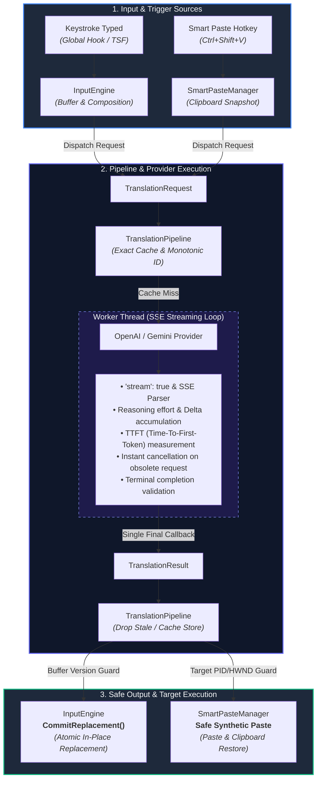

# AI Input Engine

AI Input Engine is a Windows-native input method that transparently transforms
text as you type in real time, before it is committed to the target application.

```
Physical Keyboard → Windows Input → AI Input Engine → Target Application
```

Type in any Windows application (Notepad, Word, browsers, VS Code, Discord, Slack, Teams...) and AI Input Engine automatically transforms the text in-place:
1. **Multilingual Live Translation**: Translate across languages (English, Spanish, Chinese Simplified, Chinese Traditional, French, German, Japanese, Portuguese, Italian).
2. **Same-Language Correction & Rewrite**: Clean up typos, missing accents, grammar errors, and style while preserving meaning and voice in the same language.
3. **Smart Paste (`Ctrl+Shift+V`)**: Instantly translate or rewrite text directly from the clipboard, synthetically paste into the active window, and seamlessly restore the user's original clipboard content.

## Architecture



## Capabilities & Architecture

- **Transform Operations**: Authoritative `Translate` vs `CorrectAndRewrite`.
- **Writing Profiles**: `Neutral` (default), `Professional`, `Casual`, `Slang`, `Custom`.
- **Supported Providers**: `Mock` (deterministic local engine), `OpenAI` (SSE Streaming Responses API with structured system instructions and reasoning effort control), `Google Gemini` (`gemini-3.7-flash`, `gemini-3.6-flash`, `gemini-3.5-flash-lite`).
- **Language Registry**: First-class support for `zh-Hans` (Chinese Simplified), `zh-Hant` (Chinese Traditional), `en`, `es`, `fr`, `de`, `ja`, `pt`, `it`, and `auto` (for translation source).
- **Security & Privacy**: API keys are securely stored in Windows Credential Manager (DPAPI); never logged or stored in plaintext.
- **Safety & Anti-Conversational Guarantees**: Strict instruction guardrails ensure the AI only translates or rewrites and never answers questions or injects conversational filler. Preserves protected tokens (URLs, emails, mentions, hashtags, code).
- **Exact Cache Identity & Monotonic IDs**: Isolation key across `providerId | model | operation | sourceLanguage | targetLanguage | profile | customInstructions | text`. Monotonic request tracking guarantees obsolete responses are discarded.

## Components

| Component | Purpose |
|---|---|
| `AIInputEngine.exe` | System tray host, hook-based input engine, Smart Paste manager, modern settings & diagnostics UI |
| `AIInputEngineTSF.dll` | Text Services Framework (TSF) text service (native IME path) |
| `aiie_unit_tests.exe` | Comprehensive unit test suite (185 deterministic tests, 0 failures) |
| `aiie_openaitest.exe` | Live OpenAI connectivity, translation, streaming, and rewrite validation tool |
| `aiie_geminitest.exe` | Live Gemini diagnostic tool |
| `aiie_tsfhost.exe` | TSF host proof tool verifying composition -> transformation -> commit |
| `aiie_tsfreg.exe` | Per-user TSF registration / unregistration / verification tool |
| `aiie_integration_test.exe` | Automated Notepad hook integration test |

## Quick Start

Requirements: Windows 10/11 x64, Visual Studio 2026 (or 2022) Build Tools with "Desktop development with C++", CMake 3.24+.

```powershell
# Build in Release mode
cmake -S . -B build -G "Visual Studio 18 2026" -A x64
cmake --build build --config Release --parallel

# Run unit tests
.\build\Release\aiie_unit_tests.exe

# Run live OpenAI smoke test matrix
.\build\Release\aiie_openaitest.exe --matrix

# Create portable distribution package
.\tools\package_dist.ps1
```

## Hotkeys (Configurable)

| Action | Default |
|---|---|
| Toggle AI Input | `Ctrl+Shift+Space` |
| Smart Paste | `Ctrl+Shift+V` |
| Swap Source ↔ Target | `Ctrl+Shift+S` |
| Diagnostics Window | `Ctrl+Shift+D` |

## License

MIT — see [LICENSE](LICENSE).